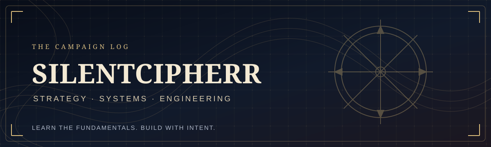
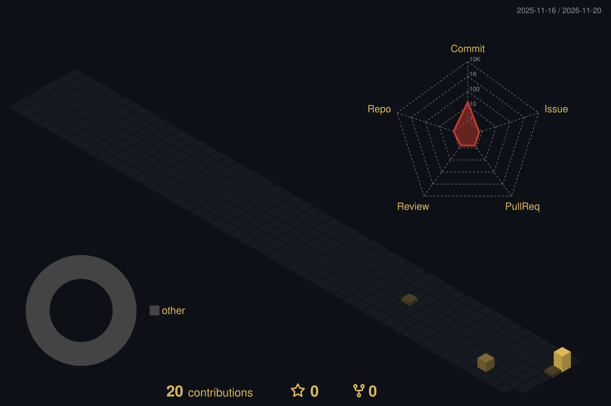

<!-- SilentCipherR | Napoleon-inspired profile -->

  

<h1 align="center">SILENTCIPHERR</h1>

  <b>Computer Science Student · Competitive Programming · AI Infrastructure</b> 
  <i>Understand the fundamentals. Engineer what comes next.</i>

  

---

## I. THE STRATEGIST

I'm a student exploring computer science through algorithms, systems, and hands-on engineering. I enjoy understanding how things work beneath the surface — from the logic behind a solution to the hardware that executes it.

- **Problem solving:** data structures, algorithms, and competitive programming
- **Systems:** Linux, programming fundamentals, and the tools behind reliable software
- **AI infrastructure:** GPU computing, model performance, and efficient execution
- **Approach:** learn by building, measure results, and improve through iteration

## II. THE CAMPAIGN

  
  
  

| Focus | Current direction |
|:--|:--|
| **Algorithms** | Data structures, problem solving, contest practice |
| **Foundations** | Python, Linux, Git, and C++ |
| **AI systems** | PyTorch, CUDA, Triton, GPU performance engineering |

## III. THE ARSENAL

**Languages & foundations**

  
  
  
  
  

**Exploring · AI & GPU computing**

  
  
  

## IV. THE FIELD NETWORK

  
  
  
  

## V. THE CHRONICLE

  

## VI. THE HONOURS

  

---

  <i>“Victory belongs to the most persevering.”</i> 
  — A saying attributed to Napoleon Bonaparte

